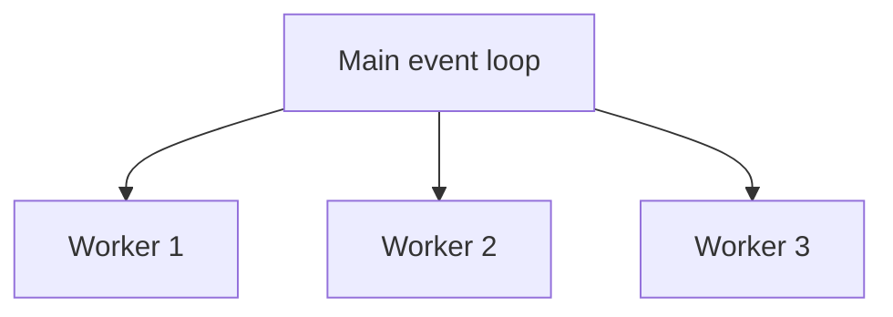

# Question 2 — Node.js concurrency

**Backend / Node.js — Senior**

Consider this API endpoint:

```typescript
app.get("/calculate", async (req, res) => {
  const result = heavyCalculation();
  res.json({ result });
});

function heavyCalculation(): number {
  let result = 0;

  for (let i = 0; i < 1_000_000_000; i++) {
    result += Math.sqrt(i);
  }

  return result;
}
```

Imagine 100 users send requests simultaneously.

1. What happens to the Node.js server?

<textarea name="q2-1" rows="3" placeholder="Your answer"></textarea>

2. Does declaring the handler async help?

<textarea name="q2-2" rows="3" placeholder="Your answer"></textarea>

3. How would you solve this problem in production?

<textarea name="q2-3" rows="3" placeholder="Your answer"></textarea>

4. Would Promise.all() help here?

<textarea name="q2-4" rows="3" placeholder="Your answer"></textarea>


<!-- pagebreak -->

## Correct answer

CPU-bound work blocks the Node.js event loop.

While heavyCalculation() executes, other JavaScript request handlers cannot run, timers and Promise callbacks are delayed, and even lightweight endpoints such as /health may become unresponsive.

The async keyword doesn't move work to another thread.

```typescript
async function calculate() {
  return heavyCalculation(); // Still blocks!
}
```

Even this doesn't help:

```typescript
await Promise.resolve().then(heavyCalculation);
```

The calculation executes in a microtask on the same JavaScript thread.

### How to solve it

Node.js provides Worker Threads for CPU-intensive calculations.



```typescript
import { Worker } from "node:worker_threads";

function calculate(): Promise<number> {
  return new Promise((resolve, reject) => {
    const worker = new Worker("./worker.js");

    worker.once("message", resolve);
    worker.once("error", reject);
    worker.once("exit", code => {
      if (code !== 0) {
        reject(new Error(`Worker exited: ${code}`));
      }
    });
  });
}
```

In production, use a bounded worker pool rather than create a worker per request. Piscina can manage worker reuse and concurrency. Other approaches include separate processing services, job queues, and horizontal scaling.

Promise.all() coordinates asynchronous operations but doesn't make synchronous CPU work execute in parallel. It is useful for concurrent I/O.

| Java | Node.js |
|---|---|
| Platform threads | Worker threads |
| Virtual threads | No direct equivalent |
| ExecutorService | Worker pool |
| CompletableFuture.allOf() | Promise.all() |
| CPU parallelism via threads | CPU parallelism via workers |

Java virtual threads don't make CPU-intensive calculations faster either. Their primary benefit is efficient concurrency for blocking operations.
