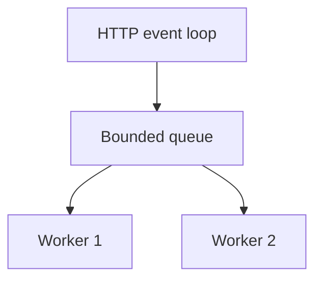

# Node.js backend

## CPU and I/O
A synchronous billion-iteration calculation blocks the event-loop thread, delaying even health checks. async and Promise.all do not parallelize CPU work. Use worker_threads or a bounded pool such as Piscina. Size against available CPU, limit queue depth and reject overload. Java virtual threads help blocking I/O concurrency rather than CPU throughput.

Network I/O can proceed outside the JS thread; some filesystem, DNS and crypto operations use libuv workers.

## Streams
Use pipeline for large files and backpressure. If write returns false, wait for drain. Avoid buffering entire payloads.

## API and persistence
Separate routes, services and repositories. Validate input, authenticate and authorize separately. Use parameterized SQL, connection pools, transactions and database constraints. An atomic conditional UPDATE prevents overselling; check affected rows. Persist idempotency keys atomically with outcomes. An outbox supports durable event publication.

## Reliability
Use deadlines, bounded retries with jitter, rate limits and graceful shutdown. Monitor event-loop lag, heap, queue depth and p99 latency. Explain how these metrics distinguish CPU saturation from slow downstream I/O.
