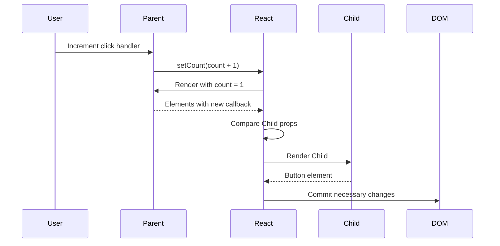

# Question 9 — React rendering and memoization

**React / Performance — Senior**

```tsx
import { useState, memo } from "react";

const Child = memo(function Child({
  onClick
}: {
  onClick: () => void;
}) {
  console.log("Child rendered");

  return <button onClick={onClick}>Click</button>;
});

function Parent() {
  const [count, setCount] = useState(0);

  const handleClick = () => {
    console.log("Clicked");
  };

  return (
    <div>
      <p>Count: {count}</p>
      <Child onClick={handleClick} />
      <button onClick={() => setCount(count + 1)}>
        Increment
      </button>
    </div>
  );
}
```

1. When the Increment button is clicked, does Child re-render?

<textarea name="q9-1" rows="3" placeholder="Your answer"></textarea>

2. Why doesn't React.memo() prevent it?

<textarea name="q9-2" rows="3" placeholder="Your answer"></textarea>

3. How would you fix the unnecessary re-render?

<textarea name="q9-3" rows="3" placeholder="Your answer"></textarea>


Bonus: Would you always apply this optimization in production?

<textarea name="q9-Bonus" rows="3" placeholder="Your answer"></textarea>


<!-- pagebreak -->

## Correct answer

1. Yes. Child re-renders when Parent renders because handleClick is a new function reference.
2. React.memo compares each prop using Object.is by default. The callback reference changes even though its behavior is identical.
3. Use useCallback with the appropriate dependencies:

```tsx
import { useCallback } from "react";

const handleClick = useCallback(() => {
  console.log("Clicked");
}, []);
```

The stable callback lets memo skip a parent-driven render when other props are unchanged. Local state and context changes can still trigger renders.

**Bonus:** No. Measure first; memoization adds overhead and complexity. Use it when the avoided rendering work is meaningful.

## What does rendering actually mean?

React rendering means calling a component function to calculate what the UI should look like. It is not the same as drawing pixels or updating the DOM.

For the initial mount, React calls Parent, which returns React elements describing a div, paragraph, Child and Increment button. React then processes those elements and calls Child. Only after the render work is ready does React commit the DOM changes.

When Increment is clicked:



1. The event handler runs using the state snapshot from the previous render.
2. setCount queues an update. React normally batches updates from the handler.
3. React calls Parent with the updated state.
4. Parent creates a new handleClick function and returns new React elements.
5. React reconciles the returned tree against the previous tree. The Child component has the same type and position, so its identity and state are preserved.
6. React compares the old and new Child props. Because onClick has a new reference, memo cannot skip this render.
7. React calls Child, which logs "Child rendered" and returns its button element.
8. React commits the necessary changes. The count text changes; the existing button can be reused. React also updates its event-handler bookkeeping as needed.
9. The browser paints when appropriate.

This is the conceptual order for this simple example, not a guarantee of exactly one function call per update. Concurrent rendering can be interrupted, restarted or discarded; development Strict Mode can call component functions extra times. A console log during rendering is not proof of a DOM commit.

### Render versus reconciliation versus commit

| Phase | What happens |
|---|---|
| Trigger | Initial mount, state update, or another relevant update schedules work |
| Render / reconciliation | React calls components as needed and determines how the tree should change |
| Commit | React applies necessary DOM changes and runs layout effects |
| Browser paint | The browser displays the result |
| Passive effects | useEffect runs after commit; its timing relative to paint can vary |

React can render a component without changing any visible DOM. Conversely, memo can avoid calling a component while React still updates other parts of the tree.

## How memo compares props

memo is a higher-order React API that returns a memoized component. By default, it compares each old prop with its corresponding new prop using Object.is. It does not recursively compare object contents or function bodies.

```typescript
Object.is(42, 42);             // true
Object.is("Alice", "Alice");   // true
Object.is({}, {});             // false
Object.is(() => {}, () => {}); // false

const callback = () => {};
Object.is(callback, callback); // true
```

The two arrow functions have identical code but are different objects. The same applies to object and array literals created inside Parent.

```tsx
<Child onClick={() => console.log("Clicked")} />
<Profile options={{ theme: "dark" }} />
<List items={[1, 2, 3]} />
```

Each of these props receives a new reference on every parent render. A memoized child receiving any of these changed props cannot use the default prop-comparison bailout.

### Java comparison

Think of Java reference equality (== for objects), rather than a custom equals() implementation. Two newly constructed objects can contain identical values while having different identities. React's Object.is is not exactly Java == for all primitives, but the analogy is useful for objects and functions.

## useCallback versus useMemo versus memo

| API | What it preserves or skips |
|---|---|
| memo(Component) | Can skip a parent-driven component render when props are unchanged |
| useCallback(fn, deps) | Returns a stable function reference while dependencies remain unchanged |
| useMemo(factory, deps) | Returns a cached calculation result while dependencies remain unchanged |

```tsx
const handleClick = useCallback(() => {
  console.log("Clicked");
}, []);

const options = useMemo(() => ({
  theme
}), [theme]);
```

useCallback does not prevent Parent from rendering, and it does not prevent JavaScript from evaluating the function expression passed to the hook. React returns the previously cached function when dependencies match. Without memo (or another applicable bailout), stabilizing a prop alone does not generally prevent a child from rendering.

### Dependencies and stale closures

```tsx
const handleClick = useCallback(() => {
  console.log(count);
}, []); // Incorrect if the current count is needed
```

The callback captures count from its initial render. To read the latest count from that render's closure, include count in the dependency array:

```tsx
const handleClick = useCallback(() => {
  console.log(count);
}, [count]);
```

Now the callback changes whenever count changes, so memo cannot skip Child on those updates. If the callback only needs to update state based on its previous value, a functional updater can remove the need to capture count:

```tsx
const increment = useCallback(() => {
  setCount(previous => previous + 1);
}, []);
```

Do not omit dependencies merely to make memoization work.

## When memo does not help

- Child updates its own state.
- A context consumed by Child changes.
- A prop changes, including a new object, function, or JSX children reference.
- The component is remounted because its key or type changes.

memo is a performance optimization, not a semantic guarantee. React may still render a memoized component. Custom comparison functions must compare every relevant prop, including functions; ignoring changed callbacks can preserve stale closures. Deep comparison may cost more than rendering.

If React Compiler is enabled, it can automatically apply many equivalent memoization optimizations. Do not assume it is enabled in every project.

## Follow-up quiz — rendering order

Assume a normal production render, no Strict Mode, no compiler optimization, and one click after the initial mount.

```tsx
function Child() {
  console.log("Child");
  return <span>Child</span>;
}

const MemoChild = memo(Child);

function Parent() {
  const [count, setCount] = useState(0);
  console.log("Parent");

  return (
    <div>
      <MemoChild />
      <button onClick={() => setCount(c => c + 1)}>
        {count}
      </button>
    </div>
  );
}
```

What is printed on the initial mount and after clicking the button once?

<p><label><input type="radio" name="q9-render-order" value="a"> A. Parent, Child; then Parent, Child</label></p>
<p><label><input type="radio" name="q9-render-order" value="b"> B. Parent, Child; then Parent</label></p>
<p><label><input type="radio" name="q9-render-order" value="c"> C. Child, Parent; then Parent</label></p>
<p><label><input type="radio" name="q9-render-order" value="d"> D. Parent, Child; then nothing</label></p>

<!-- pagebreak -->

## Correct answer

**B. Parent, Child; then Parent.**

On mount, Parent runs before React processes and renders MemoChild. On the update, Parent renders with the new count, but MemoChild has no changed props, state or context. React can skip its function call. The button text still updates.

This illustrates the distinction between rendering a parent, rendering a child, and committing a DOM change.
