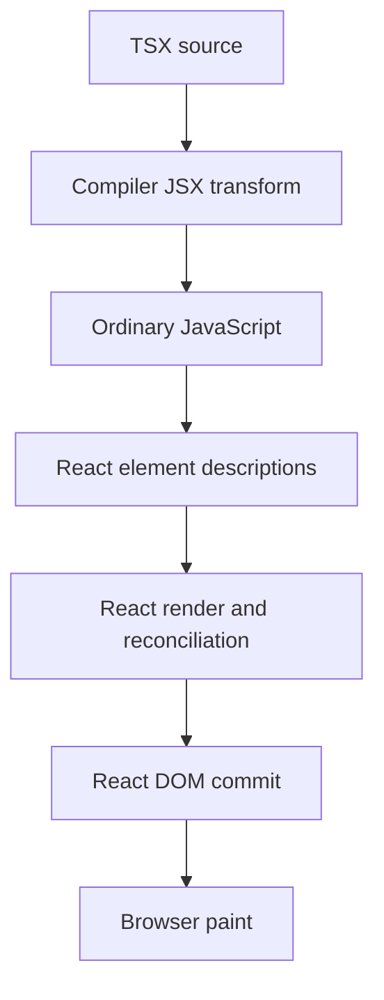

# Question 10 — How JSX works

**React / JavaScript / TypeScript — Senior**

Consider this component:

```tsx
function Greeting({ name }: { name: string }) {
  return <h1>Hello, {name}!</h1>;
}

function App() {
  return (
    <div className="container">
      <Greeting name="Alice" />
    </div>
  );
}
```

1. Is JSX valid standard JavaScript? How can the browser execute this code?

<textarea name="q10-1" rows="3" placeholder="Your answer"></textarea>

2. What JavaScript code does the JSX compiler approximately generate?

<textarea name="q10-2" rows="3" placeholder="Your answer"></textarea>

3. Does evaluating <Greeting name="Alice" /> immediately call Greeting or create a DOM element?

<textarea name="q10-3" rows="3" placeholder="Your answer"></textarea>

4. Why must a custom component normally start with an uppercase letter?

<textarea name="q10-4" rows="3" placeholder="Your answer"></textarea>

Bonus: Is JSX specific to React? Why is the file extension usually .tsx rather than .ts?

<textarea name="q10-bonus" rows="3" placeholder="Your answer"></textarea>

<!-- pagebreak -->

## Correct answer

JSX is a syntax extension, not standard JavaScript syntax. A compiler such as TypeScript, Babel, SWC or esbuild transforms it into ordinary JavaScript calls. The browser executes the resulting JavaScript, not the original JSX.

### Classic JSX transform

Conceptually, the classic React transform produces:

```js
function Greeting({ name }) {
  return React.createElement(
    "h1",
    null,
    "Hello, ",
    name,
    "!"
  );
}

function App() {
  return React.createElement(
    "div",
    { className: "container" },
    React.createElement(Greeting, {
      name: "Alice"
    })
  );
}
```

The TypeScript annotation is erased during compilation. In classic mode, React must be in scope for the generated calls.

### Modern automatic JSX transform

Modern React projects commonly use the automatic runtime. The compiler imports helpers rather than requiring React to be imported just for JSX.

```js
import {
  jsx as _jsx,
  jsxs as _jsxs
} from "react/jsx-runtime";

function Greeting({ name }) {
  return _jsxs("h1", {
    children: ["Hello, ", name, "!"]
  });
}

function App() {
  return _jsx("div", {
    className: "container",
    children: _jsx(Greeting, {
      name: "Alice"
    })
  });
}
```

The exact output depends on the compiler, configuration and development/production mode. jsx is typically used for zero or one child; jsxs for multiple static child positions. These are compiler-oriented runtime helpers.

## What does JSX return?

Evaluating JSX creates a React element: a lightweight description of a desired UI, not a DOM node and not the result of calling the component.

```tsx
const element = <Greeting name="Alice" />;
```

Conceptually, the resulting element contains:

```js
{
  type: Greeting,
  key: null,
  props: {
    name: "Alice"
  }
}
```

This is a simplified illustration, not the complete internal React element representation. React elements should be treated as opaque and immutable.

The type is the Greeting function itself. React later decides when to call that function during rendering.

Compare:

```tsx
const element = <Greeting name="Alice" />;
// Creates an element description.

const result = Greeting({ name: "Alice" });
// Directly invokes the function.
```

Do not directly call React components as a replacement for JSX. React needs to control component invocation to manage identity, hooks, state and reconciliation.

## From JSX to the DOM



There are two distinct stages:

- Build time: the compiler rewrites JSX syntax and removes TypeScript annotations.
- Runtime: React executes component functions, reconciles element descriptions and commits necessary DOM changes.

When App runs, it creates the Greeting element and the div element. React then processes the Greeting element and calls Greeting. Greeting returns an h1 element. React DOM creates or updates the corresponding browser nodes during commit.

JSX itself does not implement state, hooks, rendering, reconciliation or event handling. Those are runtime responsibilities.

## Uppercase versus lowercase

```tsx
<div />
<Greeting name="Alice" />
```

These compile approximately to:

```js
jsx("div", {});
jsx(Greeting, { name: "Alice" });
```

Lowercase tags are treated as intrinsic element names (such as div or a custom web component). Uppercase identifiers refer to JavaScript values, such as a function or class component.

This is why naming a custom component greeting and writing <greeting /> will not invoke that function.

## TypeScript and JSX

TypeScript supports JSX in .tsx files. The .ts extension normally does not enable JSX parsing. The jsx compiler option controls whether JSX is preserved for another tool or transformed by TypeScript.

| tsconfig jsx option | Behavior |
|---|---|
| react | Classic React.createElement transform |
| react-jsx | Automatic production runtime |
| react-jsxdev | Automatic development runtime |
| preserve | Preserve JSX for a later compiler |

TypeScript also checks component props and intrinsic element attributes at compile time. For example, <Greeting name={42} /> is rejected because name must be a string. That check does not validate values at runtime.

JSX is not exclusive to React. Other libraries can implement their own JSX runtimes, and TypeScript supports configuring jsxImportSource for compatible automatic runtimes.

### Java comparison

JSX is closer to compiler-supported syntax sugar than to Java reflection or a template engine. Think of a compiler rewriting a convenient expression into ordinary method calls. React elements resemble immutable UI descriptors, while the React runtime interprets and reconciles those descriptors.

## Follow-up quiz — JSX and rendering order

Assume a normal production mount without Strict Mode.

```tsx
function Child() {
  console.log("Child");
  return <span>Hello</span>;
}

function Parent() {
  console.log("A");

  const element = <Child />;

  console.log("B");

  return element;
}
```

What is printed when React mounts Parent?

<p><label><input type="radio" name="q10-order" value="a"> A. A, Child, B</label></p>
<p><label><input type="radio" name="q10-order" value="b"> B. A, B, Child</label></p>
<p><label><input type="radio" name="q10-order" value="c"> C. Child, A, B</label></p>
<p><label><input type="radio" name="q10-order" value="d"> D. A, B</label></p>

<!-- pagebreak -->

## Correct answer

**B. A, B, Child.**

Parent logs A, creates an element describing Child, logs B and returns the element. React subsequently calls Child while rendering the tree.

If Parent directly called Child() instead of evaluating JSX, Child would log between A and B. That would be an ordinary JavaScript function call, not the normal React component boundary.

## References

- [React: Writing Markup with JSX](https://react.dev/learn/writing-markup-with-jsx)
- [React: createElement](https://react.dev/reference/react/createElement)
- [TypeScript: JSX](https://www.typescriptlang.org/docs/handbook/jsx.html)
